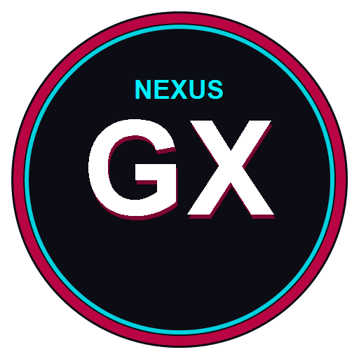

# NEXUS GX — Navegador Web Gamer de Alto Rendimiento



**Nexus GX** es un navegador web de escritorio **real** basado en **Chromium** y desarrollado con **Electron**, **React**, **TypeScript**, **Vite** y **Tailwind CSS**. Inspirado en la estética futurista y la cultura gamer, combina una interfaz ultra-personalizable con herramientas avanzadas de control de rendimiento y un sistema de audio interactivo.

---

## 🚀 Características Principales

### 1. Motor de Navegación Real (Chromium)
- **Vistas web aisladas**: Basado en `WebContentsView` de Electron para renderizado nativo de páginas web externas sin comprometer la interfaz ni la seguridad.
- **Multitarea por pestañas**: Crear, cerrar, duplicar, fijar y reordenar pestañas.
- **Navegación completa**: Botones de atrás, adelante, recargar, detener carga e inicio (`nexus://newtab`).
- **Barra de direcciones inteligente**: Soporte para búsqueda directa con **Google**, **Bing**, **DuckDuckGo**, **Brave** o **Ecosia**, o navegación directa por URLs con autocompletado HTTPS.
- **Zoom de página**: Ajuste rápido de zoom (25% a 500%).
- **Seguridad**: Context Isolation activado, Sandbox en páginas externas, Node.js deshabilitado en webs de terceros, cabecera *Do Not Track* y bloqueo configurable de pop-ups.

### 2. Panel GX Control (Monitoreo Técnico Real)
- **Medición de CPU y RAM del sistema**: Datos en tiempo real obtenidos directamente a través de las APIs del sistema operativo y métricas de Electron (`app.getAppMetrics()`).
- **Lista de procesos por pestaña**: Muestra el PID real, el consumo de memoria en MB y el uso de CPU de cada pestaña abierta.
- **Suspensión inteligente de pestañas (RAM Saver)**: Descarga las pestañas inactivas en segundo plano para liberar memoria RAM inmediatamente, restaurándolas al hacer clic.
- **Perfiles de rendimiento**:
  - **Eco Saver**: Ahorro de recursos y energía para laptops.
  - **Balanced**: Uso óptimo para navegación diaria.
  - **Ultra Gaming**: Máxima aceleración por GPU y prioridad para sesiones de juego.

### 3. Personalización Gamer y Temas RGB
- **7 Temas predeterminados**:
  1. *Cyberpunk* (Rosa Neón y Cian)
  2. *Neon Purple* (Violeta Eléctrico y Magenta)
  3. *Crimson Red* (Rojo Carmesí y Naranja)
  4. *Ice Blue* (Azul Glaciar y Azul Profundo)
  5. *Matrix Green* (Verde Terminal Hacker)
  6. *Minimal Dark* (Gris Sigiloso y Blanco Suave)
  7. *RGB Gamer* (Gradiente cromático en movimiento continuo)
- **Editor visual de temas**: Modificación en vivo de colores primarios, secundarios, intensidad del resplandor neón, radio de bordes y desenfoque acrílico.
- **Importación y exportación**: Guarda y comparte temas personalizados en formato `.json`.

### 4. Fondos de Pantalla Animados y Personalizados
- **Fondos incluidos generados en tiempo real (Canvas 60 FPS)**:
  - *Cyber Grid 3D*: Malla de perspectiva tridimensional retrofuturista con estrellas flotantes.
  - *Synthwave Sun*: Sol ochentero con scanlines horizontales y cielo estrellado.
  - *Matrix Rain*: Lluvia de código digital en verde neón.
- **Soporte para fondos locales**:
  - Imágenes estáticas (`JPG`, `PNG`, `WEBP`).
  - Animaciones (`GIF`).
  - Videos en bucle (`MP4`, `WEBM`).
- **Controles de imagen**: Ajuste milimétrico de brillo y desenfoque (blur).

### 5. Sistema de Sonido de Teclado y Efectos UI
- **Generador de sonido Web Audio API (100% libre de derechos, sin archivos externos)**:
  - *Mechanical*: Clic táctil de interruptores mecánicos azules.
  - *Thock*: Sonido grave y amortiguado de interruptores lineales/lubricados.
  - *Cyber*: Chirp futurista de modulación de frecuencia.
  - *Arcade*: Salto y efecto retro chiptune de 8 bits.
- **Efectos de interfaz**: Sonidos opcionales al abrir pestañas, cerrar pestañas, pasar el cursor por botones o completar descargas.

### 6. Reproductor Musical Integrado (BGM Player)
- **Música ambiental integrada**: Sintetizador polifónico procedural con acordes lo-fi y pads cyberpunk relajantes (*Neon Drift*, *Cyberpunk Skyline*, *Midnight Arcade Loop*).
- **Importador de música local**: Carga tus canciones en formato `MP3`, `WAV`, `OGG` o `FLAC`.
- **Visualizador dinámico**: Ecualizador gráfico de barras de neón sincronizado en tiempo real con el analizador de frecuencias de audio.
- **Atenuación inteligente (Auto-ducking)**: Baja automáticamente el volumen de la música ambiental cuando un video de YouTube, Twitch u otra pestaña reproduce audio.

### 7. Barra Lateral Gamer (Sidebar)
- Accesos rápidos integrados a **Discord**, **Twitch**, **YouTube**, **Spotify Web** y **WhatsApp Web**.
- Herramientas rápidas: GX Control, BGM Player, Historial, Marcadores, Descargas y Configuración.
- Añadir accesos directos personalizados a cualquier sitio web.

### 8. Gestores de Historial, Marcadores y Descargas
- **Historial**: Búsqueda por palabra clave, fechas formateadas, eliminación de elementos individuales o vaciado total.
- **Marcadores**: Barra de marcadores desplegable, carpetas, importación y exportación en JSON.
- **Descargas**: Progreso porcentual, velocidad en tiempo real (MB/s), pausar, reanudar, cancelar, botón de apertura directa y visualización en la carpeta del explorador.

---

## 🛠️ Arquitectura Técnica

```
c:\Navegador web\
├── .github\workflows\build.yml    # CI/CD: Compilación cruzada Windows y Linux
├── build\                         # Iconos oficiales (icon.ico, icon.png)
├── dist-installers\               # Artefactos compilados (.exe NSIS, etc.)
├── src\
│   ├── main\                      # Proceso Principal de Electron
│   │   ├── index.ts               # Inicio de Electron, ciclo de vida, flags Chromium
│   │   ├── window.ts              # Ventana principal sin marcos y redimensionado
│   │   ├── tab-manager.ts         # Gestión de WebContentsView y ciclo de vida de pestañas
│   │   ├── navigation-ipc.ts      # Manejadores de IPC (comunicación segura)
│   │   ├── downloads.ts           # Gestor de descargas con Chromium
│   │   ├── system-metrics.ts      # Monitoreo de CPU/RAM del sistema y por proceso
│   │   ├── store.ts               # Persistencia de configuraciones, historial y favoritos
│   │   └── security.ts            # CSP, sandboxing y permisos por sitio
│   ├── preload\
│   │   └── index.ts               # Bridge seguro contextBridge (API window.nexusGX)
│   ├── renderer\                  # Interfaz de Usuario React + Vite + Tailwind
│   │   ├── index.html
│   │   └── src\
│   │       ├── App.tsx            # Vista raíz con barra de pestañas y contenedor
│   │       ├── components\        # TitleBar, NavigationBar, Sidebar, Modals, NewTab
│   │       ├── services\          # SoundEngine, BgmEngine, ThemeManager
│   │       └── stores\            # Estado reactivo global con Zustand
│   └── shared\
│       └── types.ts               # Tipos TypeScript compartidos
├── tests\                         # Suite de pruebas unitarias automatizadas
├── electron-builder.yml           # Configuración de instaladores Windows y Linux
├── package.json
└── tsconfig.json
```

---

## 📦 Instaladores Generados

### Windows
- **Instalador NSIS**: `dist-installers/Nexus GX Setup 1.0.0.exe` (84 MB)
  - Asistente de instalación con selección de directorio.
  - Creación automática de acceso directo en el Escritorio.
  - Acceso directo en el menú Inicio de Windows.
  - Desinstalador limpio y configurable.
  - Asociación de protocolos web (`http`, `https`, `nexus`).
- **Versión Portátil sin empaquetar**: `dist-installers/win-unpacked/Nexus GX.exe`

### Linux (Debian / Ubuntu / RedHat / AppImage)
El proyecto incluye la configuración para empaquetar en sistemas Linux:
- Paquete `.deb` para Debian y Ubuntu.
- Archivo universal `.AppImage`.
- Paquete `.rpm` para Fedora y RedHat.
- Integración en el menú del sistema mediante categorías `Network;WebBrowser;`.
- Flujo automatizado en `.github/workflows/build.yml` listo para GitHub Actions.

---

## 💻 Instrucciones de Desarrollo

### Requisitos previos
- Node.js 18+ o 22+ LTS
- npm 9+

### Instalación de dependencias
```bash
npm install
```

### Ejecutar suite de pruebas
```bash
npm test
```

### Compilar código fuente
```bash
npm run build
```

### Iniciar en modo desarrollo
```bash
npm start
```

### Generar instalador para Windows
```bash
npm run pack:win
```

### Generar paquetes para Linux
```bash
npm run pack:linux
```

---

## 🔒 Seguridad y Compatibilidad

1. **Aislamiento de contexto**: Todas las páginas externas operan en un entorno estrictamente aislado del proceso de Electron mediante `contextIsolation: true` y `nodeIntegration: false`.
2. **Permisos de sitios**: Se rechazan por defecto solicitudes de acceso de bajo nivel; los permisos de cámara, micrófono y notificaciones requieren validación.
3. **Servicios DRM (Widevine)**: Los servicios que requieren módulos propietarios de protección DRM (como Netflix o Spotify en alta definición con DRM cerrado) requieren licencias binarias de Google Widevine para Chromium empaquetado. Nexus GX abre las versiones web compatibles de estos servicios.

---

## 📄 Licencia

Este proyecto está bajo licencia MIT. Desarrollado como navegador gamer de nueva generación.
